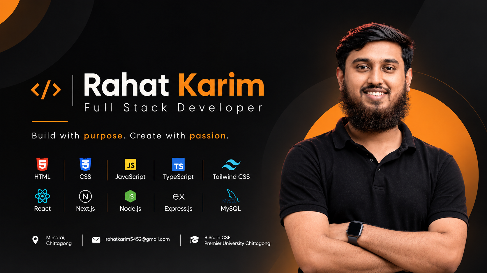

 

  

<a href="#about-me">About</a> &nbsp;·&nbsp;
<a href="#technical-skills">Skills</a> &nbsp;·&nbsp;
<a href="#featured-projects">Projects</a> &nbsp;·&nbsp;
<a href="#github-statistics">Stats</a> &nbsp;·&nbsp;
<a href="#education">Education</a> &nbsp;·&nbsp;
<a href="#connect-with-me">Contact</a>

---

## About Me

Hi, I'm **Rahat Karim** (you can call me **Jisan**), a Full Stack Developer from Mirsarai, Chittagong, currently pursuing my B.Sc. in Computer Science and Engineering at Premier University, Chittagong.

I enjoy working across the whole stack: building responsive interfaces with React, Next.js, and Tailwind CSS, writing server-side logic and APIs with Node.js and Express.js, and structuring data in MySQL. What draws me to full-stack development is watching an idea grow from an empty screen into a working product, and understanding every layer that makes it work.

I like problems that make me think, whether that means tracking down a stubborn bug, designing a cleaner data model, or finding a simpler way to structure a component. I care about writing code that is readable, maintainable, and built for real users.

I'm looking for opportunities to apply what I've learned, contribute to a team, and keep growing as a developer.

- **Role:** Full Stack Developer
- **Location:** Mirsarai, Chittagong, Bangladesh
- **Education:** B.Sc. in CSE, Premier University, Chittagong (in progress)
- **Core Stack:** React.js · Next.js · Node.js · Express.js · MySQL
- **Contact:** [rahatkarim5452@gmail.com](mailto:rahatkarim5452@gmail.com)

---

## Technical Skills

<table>
  <tr>
    <td width="200" valign="middle"><b>Frontend</b> Interfaces &amp; styling</td>
    <td valign="middle">
       
      HTML · CSS · Tailwind CSS · React.js · Next.js
    </td>
  </tr>
  <tr>
    <td width="200" valign="middle"><b>Backend</b> Server-side &amp; APIs</td>
    <td valign="middle">
       
      Node.js · Express.js
    </td>
  </tr>
  <tr>
    <td width="200" valign="middle"><b>Database</b> Data storage</td>
    <td valign="middle">
       
      MySQL
    </td>
  </tr>
  <tr>
    <td width="200" valign="middle"><b>Programming Languages</b> Core languages</td>
    <td valign="middle">
       
      JavaScript · TypeScript
    </td>
  </tr>
</table>

<!-- Optional: add a "Tools & Workflow" row here (e.g. Git, VS Code) once you're ready to list them. -->

---

## Featured Projects

A selection of projects I've built. Each card links to the live demo and source code.

<!-- Replace every [placeholder] below with your real project details. Replace the placeholder image with a screenshot, e.g. ./assets/projects/project-01.png -->

<table>
  <tr>
    <td width="45%" valign="top">
      
    </td>
    <td width="55%" valign="top">
      <b>PROJECT 01</b>
      <h3>[Project Name]</h3>
      
[One or two sentences describing what the project does, who it is for, and the problem it solves.]

      
<b>Tech Stack:</b> <code>[Tech 1]</code> · <code>[Tech 2]</code> · <code>[Tech 3]</code>

      

        
        
      

    </td>
  </tr>
</table>

<table>
  <tr>
    <td width="45%" valign="top">
      
    </td>
    <td width="55%" valign="top">
      <b>PROJECT 02</b>
      <h3>[Project Name]</h3>
      
[One or two sentences describing what the project does, who it is for, and the problem it solves.]

      
<b>Tech Stack:</b> <code>[Tech 1]</code> · <code>[Tech 2]</code> · <code>[Tech 3]</code>

      

        
        
      

    </td>
  </tr>
</table>

<table>
  <tr>
    <td width="45%" valign="top">
      
    </td>
    <td width="55%" valign="top">
      <b>PROJECT 03</b>
      <h3>[Project Name]</h3>
      
[One or two sentences describing what the project does, who it is for, and the problem it solves.]

      
<b>Tech Stack:</b> <code>[Tech 1]</code> · <code>[Tech 2]</code> · <code>[Tech 3]</code>

      

        
        
      

    </td>
  </tr>
</table>

More of my work is available in my [GitHub repositories](https://github.com/YOUR_GITHUB_USERNAME?tab=repositories).

---

## GitHub Statistics

 

### Contribution Activity

---

## Education

**Bachelor of Science in Computer Science and Engineering (B.Sc. in CSE)**
Premier University, Chittagong

- **Status:** Currently pursuing
- **Expected Graduation:** `[Year]`
- **Relevant Coursework:** `[Optional: e.g. courses you want to highlight]`

<!-- Optional: add CGPA, academic achievements, or university activities here if you'd like to include them. -->

---

## Career Interests

<table>
  <tr>
    <td width="33%" valign="top">
      <b>Full Stack Development</b>  
      Connecting interface, API, and database into complete, reliable web applications.
    </td>
    <td width="33%" valign="top">
      <b>Frontend Development</b>  
      Building responsive, user-focused interfaces with React, Next.js, and Tailwind CSS.
    </td>
    <td width="33%" valign="top">
      <b>Backend Development</b>  
      Designing APIs and server-side logic with Node.js and Express.js, backed by MySQL.
    </td>
  </tr>
</table>

---

## Current Focus

- Completing my B.Sc. in Computer Science and Engineering at Premier University, Chittagong
- Building and refining full-stack projects with React, Next.js, Node.js, Express.js, and MySQL
- Writing cleaner, more maintainable code
- Finding an opportunity to contribute to a team and learn from experienced developers

---

## Currently Learning

<!-- Edit this table so it reflects what you're actually working on right now. -->

| Area | What I'm Improving |
| :--- | :--- |
| **TypeScript** | Writing safer, more maintainable code with strong typing across frontend and backend |
| **Next.js** | Routing, data fetching, and rendering strategies for modern web applications |
| **Backend & APIs** | Designing cleaner, better-structured REST APIs with Node.js and Express.js |
| **Databases** | Schema design and query writing in MySQL |
| **Problem Solving** | Strengthening computer science fundamentals, data structures, and algorithms |
| `[Your next skill]` | `[What you're exploring]` |

---

## Development Philosophy

> **Build with purpose. Create with passion.**

- **Purpose first.** Every feature should solve a real problem for a real user.
- **Clarity over cleverness.** Readable, maintainable code outlasts clever shortcuts.
- **Details matter.** Responsive layouts, thoughtful UX, and clean structure separate good work from great work.
- **Keep learning.** Technology moves quickly. Strong fundamentals and curiosity keep me adaptable.

---

## Connect With Me

I'm open to new opportunities and conversations. Email is the best way to reach me.

<!-- Optional:  -->

---

**Thanks for visiting my profile.**

If my work looks like a good fit for your team or project, I'd be glad to hear from you.

Build with purpose. Create with passion.

