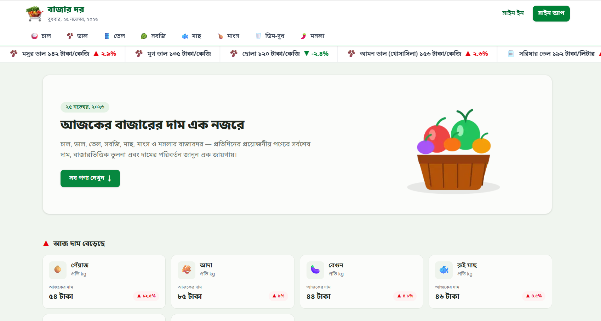
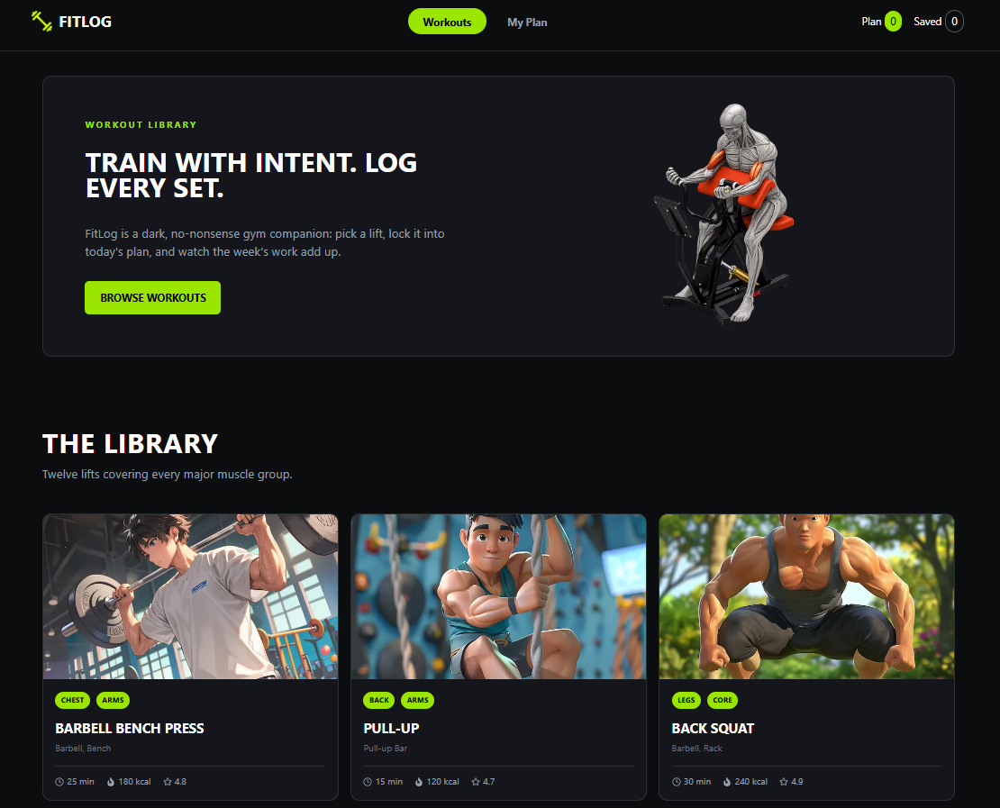
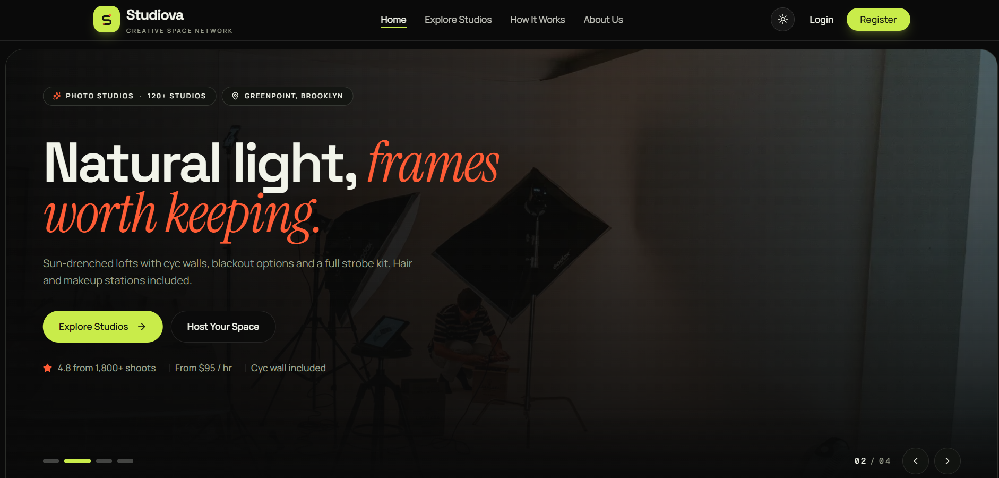

<h1>Rahat Karim | Full Stack Developer</h1>
 

 

  

<a href="#about-me">About</a> &nbsp;·&nbsp;
<a href="#technical-skills">Skills</a> &nbsp;·&nbsp;
<a href="#featured-projects">Projects</a> &nbsp;·&nbsp;
<a href="#github-statistics">Stats</a> &nbsp;·&nbsp;
<a href="#education">Education</a> &nbsp;·&nbsp;
<a href="#connect-with-me">Contact</a>

---

## About Me

Hi, I'm **Rahat Karim**, a Full Stack Developer from Chittagong, Bangladesh, currently pursuing my B.Sc. in Computer Science and Engineering at Premier University, Chittagong.

I enjoy working across the whole stack: building responsive interfaces with React, Next.js, and Tailwind CSS, developing server-side logic and APIs with Node.js and Express.js, and managing data with databases.

I enjoy solving problems, learning new technologies, and turning ideas into practical digital products. I care about writing clean, readable, and maintainable code.

I'm looking for opportunities to apply what I've learned, contribute to a team, and continue growing as a developer.

- **Role:** Full Stack Developer
- **Location:** Chittagong, Bangladesh
- **Education:** B.Sc. in CSE, Premier University (in progress)
- **Core Stack:** React.js · Next.js · Node.js · Express.js · MongoDB
- **Contact:** [rahatkarim5452@gmail.com](mailto:rahatkarim5452@gmail.com)

---

## Technical Skills

<table>
  <tr>
    <td width="200" valign="middle"><b>Frontend</b> Interfaces & styling</td>
    <td valign="middle">
       
      HTML · CSS · Tailwind CSS · React.js · Next.js
    </td>
  </tr>
  <tr>
    <td width="200" valign="middle"><b>Backend</b> Server-side & APIs</td>
    <td valign="middle">
       
      Node.js · Express.js
    </td>
  </tr>
  <tr>
    <td width="200" valign="middle"><b>Database</b> Data storage</td>
    <td valign="middle">
       
      MySQL · MongoDB
    </td>
  </tr>
  <tr>
    <td width="200" valign="middle"><b>Programming Languages</b> Core languages</td>
    <td valign="middle">
       
      JavaScript · TypeScript
    </td>
  </tr>
</table>

---

## Featured Projects

A selection of projects I've built. Each project includes its live demo and source code.

<table>
  <tr>
    <td width="45%" valign="top">
      
    </td>
    <td width="55%" valign="top">
      <b>PROJECT 01</b>
      <h3>BazarDor</h3>
      
Daily market prices of essential goods at a glance. Track prices of rice, lentils, oil, vegetables, fish, meat, and spices. Compare prices across markets and see daily price changes in one place.

      
<b>Tech Stack:</b> <code>React</code> · <code>Next.js</code> · <code>Tailwind CSS</code>

      

        
        
      

    </td>
  </tr>
</table>

<table>
  <tr>
    <td width="45%" valign="top">
      
    </td>
    <td width="55%" valign="top">
      <b>PROJECT 02</b>
      <h3>FitLog</h3>
      
FitLog is a modern workout library and workout planning application built to help users explore workouts and organize their fitness routines.

      
<b>Tech Stack:</b> <code>React</code> · <code>Next.js</code> · <code>TypeScript</code> · <code>Tailwind CSS</code>

      

        
        
      

    </td>
  </tr>
</table>

<table>
  <tr>
    <td width="45%" valign="top">
      
    </td>
    <td width="55%" valign="top">
      <b>PROJECT 03</b>
      <h3>Studiova</h3>
      
Studiova is a peer-to-peer marketplace for creative workspaces. Hosts can list photo studios, sound stages, podcast rooms, music suites, and art workshops. Creators can explore spaces, choose their hours, and send booking requests.

      
<b>Tech Stack:</b> <code>React</code> · <code>Better Auth</code> · <code>Express.js</code> · <code>MongoDB</code>

      

        
        
      

    </td>
  </tr>
</table>

More of my work is available in my [GitHub repositories](https://github.com/Rahat-Karim5452?tab=repositories).

---

## GitHub Statistics

 

### Contribution Activity

---

## Education

**Bachelor of Science in Computer Science and Engineering (B.Sc. in CSE)**

Premier University, Chittagong

- **Status:** Currently pursuing

---

## Career Interests

<table>
  <tr>
    <td width="33%" valign="top">
      <b>Full Stack Development</b>  
      Connecting interfaces, APIs, and databases into complete web applications.
    </td>
    <td width="33%" valign="top">
      <b>Frontend Development</b>  
      Building responsive, user-focused interfaces with React, Next.js, and Tailwind CSS.
    </td>
    <td width="33%" valign="top">
      <b>Backend Development</b>  
      Developing APIs, authentication systems, and server-side applications.
    </td>
  </tr>
</table>

---

## Current Focus

- Building and refining full-stack projects.
- Improving TypeScript and Next.js skills.
- Developing backend APIs and authentication systems.
- Learning better database design and application architecture.
- Writing clean and maintainable code.

---

## Currently Learning

| Area | What I'm Improving |
| :--- | :--- |
| **TypeScript** | Writing safer and more maintainable code |
| **Next.js** | Routing, data fetching, and rendering strategies |
| **Backend & APIs** | Building structured REST APIs with Node.js and Express.js |
| **Databases** | Schema design and query writing |
| **Problem Solving** | Strengthening programming fundamentals and algorithms |

---

## Development Philosophy

> **Build with purpose. Create with passion.**

- **Purpose first.** Every feature should solve a real problem.
- **Clarity over cleverness.** Readable code is maintainable code.
- **Details matter.** Responsive layouts and thoughtful UX make a difference.
- **Keep learning.** Strong fundamentals and curiosity keep me growing.

---

## Connect With Me

I'm open to new opportunities and conversations. Feel free to reach out.

  

**Thanks for visiting my profile.**

Build with purpose. Create with passion.

